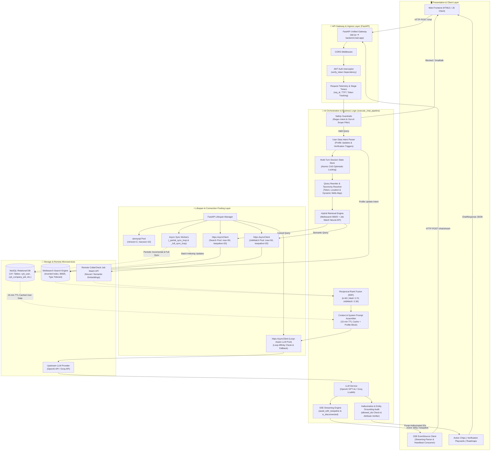
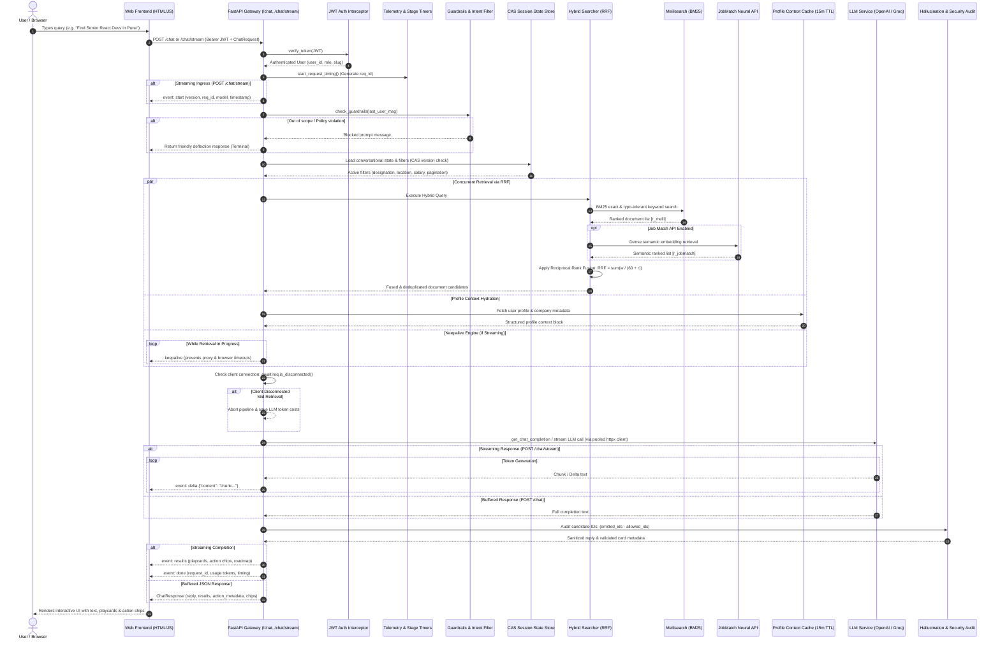

# CollarCheck Chatbot & Search Backend Architecture

Welcome to the **CollarCheck Chatbot & Search Engine** backend documentation. This document provides a comprehensive technical overview of the application architecture, API routes, authentication keys, database schema, SQL joins, AI/LLM flow, data transfer budgets, hybrid search pipelines, multi-turn state concurrency, and overall system design.

---

## 🏗️ System Architecture Overview

The CollarCheck AI Chatbot & Search Engine is engineered as an enterprise-grade, asynchronous, event-driven retrieval-augmented generation (RAG) platform. It provides high-speed hybrid candidate/job discovery, multi-turn stateful conversational interactions, employment verification roadmaps, and deterministic entity grounding.

### 📊 System Architecture Flowchart



---

## 🔑 Environment Variables & API Keys

All operational credentials and configuration settings are defined in the [`.env`](file:///c:/UNG/chatbot_Quadrant/.env) file (see [`.env.example`](file:///c:/UNG/chatbot_Quadrant/.env.example) for template):

| Variable Name | Purpose | Default / Example Value |
| :--- | :--- | :--- |
| `SEARCH_API_KEY` | Bearer token required to access public search routes (`/search/*`). | Configured in `.env` |
| `MEILI_URL` | Base URL of the Meilisearch container instance. | `http://localhost:7701` |
| `MEILI_MASTER_KEY` | Administrative master key for Meilisearch operations. | `masterKey123` |
| `PLATFORM_TEST_TOKEN` / `EMPLOYEE_JWT` | Bearer JWT token used to call remote platform APIs. | JWT string |
| `DB_HOST`, `DB_PORT`, `DB_USER`, `DB_PASSWORD`, `DB_NAME` | Connection details for the MySQL production relational database (`collarcheck`). | `localhost:3306`, `root`, `collarcheck` |
| `DB_PATH` | Local SQLite fallback / prototype database path. | `backend/collarcheck.db` |
| `OPENAI_API_KEY` / `GROQ_API_KEY` | API key for calling OpenAI GPT or Groq Llama models for chat completions. | `sk-...` / `gsk_...` |
| `JWT_SECRET` | Secret key used for signing and validating session JWTs. | `collarcheck_prototype_secret_key_123` |
| `JWT_ALGORITHM` | Algorithm used for JWT encoding/decoding. | `HS256` |
| `JOB_MATCH_API_BASE_URL` | Remote endpoint for CollarCheck Job Match neural/semantic retrieval. | `https://ai.collarcheck.com/jobmatch` |
| `JOB_MATCH_API_KEY` | Authentication key for Job Match API. | Configured in `.env` |
| `JOB_MATCH_ENABLED` | Toggle flag for enabling remote Job Match API retrieval. | `false` / `true` |
| `JOB_MATCH_TIMEOUT_SECONDS` | HTTP timeout for Job Match API requests. | `5.0` |
| `JOB_MATCH_LIMIT` | Max candidate/job records requested from Job Match API. | `11` |
| `HYBRID_SEARCH_ENABLED` | Master switch for Reciprocal Rank Fusion (RRF) search. | `true` |
| `HYBRID_MEILISEARCH_WEIGHT` | RRF fusion weight multiplier for Meilisearch results. | `0.70` |
| `HYBRID_JOBMATCH_WEIGHT` | RRF fusion weight multiplier for Job Match results. | `0.30` |
| `HYBRID_RRF_K` | Smoothing constant $k$ used in the RRF ranking formula. | `60` |
| `HYBRID_RETRIEVAL_LIMIT` | Maximum candidates/jobs to fetch before ranking. | `30` |
| `PLATFORM_MEDIA_BASE_URL` | Base domain for user avatars and company media. | `https://admin.collarcheck.com` |
| `ALLOWED_MEDIA_DOMAINS` | Whitelist of domains allowed for avatar/media rendering. | `admin.collarcheck.com,www.collarcheck.com,...` |

---

## 🔌 API Routes & Endpoints

### 1. Chat & Conversational AI Routes ([`backend/main.py`](file:///c:/UNG/chatbot_Quadrant/backend/main.py))

* **`POST /chat`**
  * **Function:** Main AI Chatbot entry point. Processes incoming chat messages, checks safety guardrails, updates user profile fields (if update intent is detected), fetches user profile context, queries relevant candidates or jobs via hybrid retrieval, calls OpenAI/Groq LLM, and returns formatted responses with interactive UI result cards and playcard actions.
  * **Auth Required:** Bearer JWT (`verify_token`).

* **`POST /reverse-geocode`**
  * **Function:** Converts GPS coordinates (`latitude`, `longitude`) into a location string (City, State, Country).

### 2. Search & Indexing Engine Routes ([`api.py`](file:///c:/UNG/chatbot_Quadrant/api.py) & [`backend/api/search.py`](file:///c:/UNG/chatbot_Quadrant/backend/api/search.py))

* **`GET /search/jobs`**
  * **Function:** Multi-tiered hybrid search for job listings with filtering by salary, skills, designation, department, industry, location, and role type.

* **`GET /search/users`**
  * **Function:** Candidate search engine allowing filters on verification status, skills, experience level, salary range, location, and availability (`on_immediate`, `on_notice`).

* **`GET /search/companies`**
  * **Function:** Search employer organizations by industry, location, and benefits.

* **`POST /rebuild-index`**
  * **Function:** Triggers asynchronous re-indexing of MySQL database records into Meilisearch indexes (`jobs`, `users`, `companies`).

* **`GET /health`**
  * **Function:** System health check verifying database connections, search engine status, and hybrid dependencies.

### 3. Profile Management Routes ([`backend/api/profile.py`](file:///c:/UNG/chatbot_Quadrant/backend/api/profile.py))

* **`GET /missing-fields`**: Inspects user profile completeness and returns missing fields.
* **`PUT /update`**: Updates basic profile fields (name, phone, description, gender, DOB).
* **`PUT /address`**: Updates present and permanent address lines.
* **`GET /skills` & `POST /skills`**: Retrieves or appends new user skills.
* **`GET /education` & `PUT /education`**: Retrieves or modifies user educational records.
* **`GET /employment` & `PUT /employment`**: Retrieves or modifies user work experience history.

### 4. Auth & Verification Routes ([`backend/api/auth.py`](file:///c:/UNG/chatbot_Quadrant/backend/api/auth.py), [`backend/api/employee.py`](file:///c:/UNG/chatbot_Quadrant/backend/api/employee.py), [`backend/api/employer.py`](file:///c:/UNG/chatbot_Quadrant/backend/api/employer.py))

* **`POST /auth/token`**: Generates and signs JWT tokens for authenticated platform sessions.
* **`GET /auth/verify`**: Validates incoming bearer tokens and decodes user role claims.
* **`GET /employee/verification-status`**: Retrieves multi-level verification state for employee records.
* **`POST /employee/verify`**: Submits verification evidence and triggers roadmap level updates.
* **`GET /employer/candidate-pool`**: Retrieves candidate recommendations tailored to employer parameters.

---

## 📊 Database Schema & SQL Joins

The system operates on **14+ core tables** in MySQL (indexed into Meilisearch by [`indexer.py`](file:///c:/UNG/chatbot_Quadrant/indexer.py)):

### Primary Data Tables:
1. **`cyb_user`**: Primary user table (candidates, employees, company accounts). Stores contact info, location IDs, verification flags, and profile summaries.
2. **`cyb_company_job`**: Job postings master table storing title, description, department, designation, salary ranges, and job location.
3. **`cyb_user_skill` & `cyb_skill`**: Relational junction table linking user IDs to master skill entries.
4. **`cyb_user_education`**: Stores university, course, course type (full-time vs online), start/end dates, and degree level.
5. **`cyb_user_experience`**: Stores employment history, company, designation, salary, and employment dates.
6. **`cyb_application`**: Job application logs per candidate and job posting.
7. **`cyb_company_benefits`**: Benefits offered by employer organizations.
8. **`cyb_country`**, **`cyb_state`**, **`cyb_cities`**: Location master tables.
9. **`cyb_department`**, **`cyb_designation`**, **`cyb_industries`**, **`cyb_role_types`**: Domain taxonomy tables.
10. **`designation_master` / `designation_alias` & `company_master` / `company_alias`**: Semantic normalization mapping tables for job titles and company names.

### Key SQL Joins & Relationships

During search indexing and context retrieval, the following SQL join strategy is executed:

```sql
-- Example Candidates & Experience Indexing Query (indexer.py)
SELECT 
    u.id, u.full_name, u.email, u.phone,
    cntry.name AS country_name, st.name AS state_name, ct.name AS city_name,
    desig.name AS current_position_name,
    GROUP_CONCAT(DISTINCT s.name SEPARATOR '||') AS skill_names_csv
FROM cyb_user u
LEFT JOIN cyb_country cntry      ON cntry.id = u.country
LEFT JOIN cyb_state st           ON st.id = u.state
LEFT JOIN cyb_cities ct          ON ct.id = u.city
LEFT JOIN cyb_designation desig  ON desig.id = u.current_possition
LEFT JOIN cyb_user_skill us      ON us.user = u.id AND us.status = 1 AND us.is_deleted = 0
LEFT JOIN cyb_skill s           ON s.id = us.skill
WHERE u.status = 1 AND u.is_deleted = 0
GROUP BY u.id;
```

---

## 🤖 AI Execution Flow & Data Pipeline

The chatbot engine executes a high-throughput, multi-stage processing pipeline across every request. It supports both **buffered JSON responses** (`POST /chat`) and **real-time Server-Sent Events (SSE)** (`POST /chat/stream`) with zero-downtime graceful fallbacks and client disconnection management.

### 🔀 Chatbot Data Flow & Execution Pipeline Flowchart

```mermaid
flowchart TD
    Start(["💬 User Types Message in Web UI"]) --> Ingress["FastAPI Router\n(POST /chat or /chat/stream)"]
    Ingress --> AuthCheck{"🔐 JWT Bearer Auth\n(verify_token)"}
    
    AuthCheck -->|❌ Missing or Invalid| Auth401["HTTP 401 Unauthorized\n(Return error JSON)"]
    AuthCheck -->|✅ Valid Token| Telemetry["⏱️ Telemetry & Timing\n(Generate req_id, start stage_timer)"]
    
    Telemetry --> GuardrailsCheck{"🛡️ Guardrails Check\n(Regex Intent & Safety)"}
    GuardrailsCheck -->|🚫 Out of Scope / Malicious| GuardrailsTerminal["Terminal Deflection\n(Return friendly safe reply)"]
    GuardrailsCheck -->|✅ Career Scope| IntentCheck{"🧠 Intent Parser\n(Profile update intent?)"}
    
    IntentCheck -->|✏️ Yes: Update Detected| DBUpdate["Direct MySQL Update\n(cyb_user_skill / cyb_user)"]
    DBUpdate --> StateStore
    IntentCheck -->|🔍 No: Discovery / Search| StateStore["📦 Multi-Turn Session State (CAS)\n(Load active filters & state_version)"]
    
    StateStore --> QueryRewrite["🔤 Query Rewriter & Taxonomy Resolver\n(Resolve skills, designations & locations)"]
    
    subgraph RetrievalSubsystem["⚡ Concurrent Hybrid Retrieval Subsystem"]
        QueryRewrite --> ForkRetrieval{"Parallel Retrieval"}
        ForkRetrieval -->|Lexical Match| MeiliQuery["Meilisearch (BM25)\n(Fast exact & typo-tolerant)"]
        ForkRetrieval -->|Semantic Match| JobMatchQuery["CollarCheck JobMatch API\n(Dense neural vector ranking)"]
        
        JobMatchQuery -->|Timeout >5s or Error| Fallback["Graceful Fallback\n(100% Meilisearch)"]
        MeiliQuery --> RRF_Merge["Reciprocal Rank Fusion (RRF)\nScore = sum(w / (60 + rank))\nw_meili=0.70, w_jobmatch=0.30"]
        JobMatchQuery --> RRF_Merge
        Fallback --> RRF_Merge
    end
    
    RRF_Merge --> ContextAssembly["📝 Context & Prompt Assembly\n(System Prompt + History + 15m Cached Profile + Top RRF Results)"]
    
    ContextAssembly --> ConnCheck{"📡 Client Disconnected?\n(await req.is_disconnected)"}
    ConnCheck -->|❌ Yes| AbortGen["Abort Request\n(Save LLM token spend)"]
    ConnCheck -->|✅ No| LLMCall["🤖 Pooled LLM Call\n(OpenAI GPT-4o / Groq LLaMA via httpx pool)"]
    
    LLMCall --> GroundingAudit{"🔍 Deterministic Hallucination Audit\n(Emitted IDs ⊆ Allowed IDs?)"}
    GroundingAudit -->|⚠️ Hallucinated IDs Found| PurgeIDs["Purge Fabricated Entities\n(Strip unauthorized cards)"]
    GroundingAudit -->|✅ All Grounded| FormatPayload["Format Output Payload\n(Text + Playcards + Action Chips)"]
    PurgeIDs --> FormatPayload
    
    FormatPayload --> RouteOutput{"Endpoint Type?"}
    RouteOutput -->|POST /chat| JSONResponse["Buffered JSON Response\n(ChatResponse)"]
    RouteOutput -->|POST /chat/stream| SSEResponse["SSE Event Stream\n(event: delta ➔ results ➔ done)"]
    
    JSONResponse --> End(["🖥️ UI Renders Response, Playcards & Roadmap"])
    SSEResponse --> End
```



### 🔄 End-to-End Execution Sequence Diagram



### 📋 Detailed Step-by-Step Data Journey

1. **Ingress & Authentication (`POST /chat` & `POST /chat/stream`)**:
   - The frontend issues an HTTP request containing the conversation history (`ChatRequest`), optional session identifiers, and bearer JWT tokens.
   - FastAPI dependency `verify_token` decrypts and verifies the JWT claims, resolving the user's platform identity (`u_db_id`), role (`employer` vs `candidate/employee`), and authorization privileges.
   - Unique request correlation IDs (`req_id`) are generated via `backend/utils/timing.py` and attached to logging contexts via `LogRecordFactory`.

2. **Pre-Flight Safety Guardrails (`backend/utils/utils.py`)**:
   - High-speed regex scanners intercept prohibited queries (injection attempts, off-topic prompts, system prompt leakage attacks).
   - If triggered, the pipeline terminates immediately with a safe canned deflection, avoiding unnecessary database and LLM compute charges.

3. **User Intent Classification & In-Flight Profile Updates (`user_data_intent_parser.py`)**:
   - Parses whether the conversational query carries direct profile mutation intent (e.g., *"I have 5 years experience in React"*, *"Update my current location to Bangalore"*).
   - If detected, executes direct transactional updates into MySQL tables (`cyb_user`, `cyb_user_skill`, `cyb_user_experience`) and marks local state for re-indexing.

4. **Multi-Turn Session State & Optimistic CAS Locking (`backend/utils/session_state.py`)**:
   - Loads existing session criteria (previous search filters, active salary ranges, remote/on-site job modes, candidate pagination offsets).
   - Utilizes Atomic **Compare-And-Swap (CAS)** with monotonically increasing `state_version` integers to protect against race conditions from rapid concurrent user queries or multi-tab sessions.

5. **Taxonomy Normalization & Query Rewriting (`query_rewriter.py` & `token_resolver.py`)**:
   - Resolves unstructured conversational expressions into database-backed taxonomies (e.g., mapping colloquial *"node dev"* into formal designation ID and skills `Node.js`, `Express`).
   - Normalizes geographic locations via `location_resolver.py` against city, state, and country master tables.

6. **Concurrent Hybrid Retrieval & Reciprocal Rank Fusion (RRF)**:
   - Queries **Meilisearch** for BM25 lexical keyword retrieval with typo tolerance.
   - Concurrently invokes the **CollarCheck Job Match API** for vector semantic relevance.
   - Fuses and re-ranks results using Reciprocal Rank Fusion ($k=60$, $w_{\text{meili}}=0.70$, $w_{\text{jobmatch}}=0.30$). If the external neural service times out ($>5.0\text{s}$), the engine falls back gracefully to 100% Meilisearch without dropping the request.

7. **Context Assembly & Keepalive Heartbeat (`backend/utils/sse.py`)**:
   - Combines the system prompt, bounded user history, cached profile summary (15-min TTL), and retrieved search results into a clean 2,500–3,500 token prompt payload.
   - In streaming mode, `await_with_keepalive` continuously sends SSE heartbeat comments (`: keepalive\n\n`) to prevent intermediate proxies, firewalls, and cloud load balancers from closing idle connections during retrieval.

8. **Loop-Aware Connection-Pooled LLM Generation (`backend/services/llm_service.py`)**:
   - Calls OpenAI GPT or Groq LLaMA models over a pooled `httpx.AsyncClient` (`max_connections=50`, `max_keepalive_connections=20`).
   - Dynamically validates event-loop affinity (`_app_llm_loop == current_loop`) to avoid `RuntimeError` cross-loop exceptions.
   - Checks `await req.is_disconnected()` between chunk yields; if the client closed the tab, generation halts immediately to conserve API credits.

9. **Deterministic Security Verification & Hallucination Audit (`backend/utils/retrieval_evaluator.py`)**:
   - Extracts candidate/job entity IDs from the generated text and compares against `allowed_ids` collected during search retrieval:
     $$\text{Unauthorized} = \text{Emitted IDs} - \text{Allowed IDs}$$
   - Any hallucinated IDs or fabricated cards are purged prior to UI serialization.
   - Evaluates factual consistency against expected profile attributes.

10. **Delivery & UI Rendering (`frontend/index.html`)**:
    - **Buffered Mode**: Emits structured `ChatResponse` JSON containing message text, verified result cards, action metadata, pagination tokens, and interactive suggestion chips.
    - **Streaming Mode**: Streams typed events (`start`, `delta`, `results`, `done`, `error`) parsed incrementally by the frontend `EventSource` consumer to display real-time typing indicators, candidate cards, and employment verification roadmaps.

---

## 📈 Data Budget & Volume Breakdown

| Stage | Data Format | Estimated Size / Budget |
| :--- | :--- | :--- |
| **Incoming User Query** | JSON String | ~50 – 500 bytes |
| **Profile Context Injection** | Markdown / Text Block | ~1,000 – 1,500 tokens |
| **Meilisearch Overfetch Buffer** | JSON Array | Max 200 documents |
| **LLM Total Context Window** | Prompt + System + Context | ~2,500 – 4,000 tokens |
| **LLM Output Response** | Text / JSON Cards | ~300 – 800 tokens (~1 – 3 KB) |

---

## 🔀 Advanced Hybrid Search & Reciprocal Rank Fusion (RRF)

The search layer ([`backend/services/hybrid_job_search.py`](file:///c:/UNG/chatbot_Quadrant/backend/services/hybrid_job_search.py)) implements an enterprise-grade **Reciprocal Rank Fusion (RRF)** pipeline merging:

1. **Lexical/BM25 Keyword Retrieval**: Fast exact & typo-tolerant matches from Meilisearch.
2. **Semantic / Neural Job Match API**: Deep contextual vector rankings from the remote CollarCheck Job Match engine.

### RRF Ranking Formula:
$$RRF\_Score(d) = \sum_{m \in M} \frac{w_m}{k + r_m(d)}$$

Where:
- $M = \{\text{Meilisearch}, \text{JobMatch}\}$
- $k = 60$ (smoothing constant, configured via `HYBRID_RRF_K`)
- $w_{\text{Meili}} = 0.70$ (`HYBRID_MEILISEARCH_WEIGHT`)
- $w_{\text{JobMatch}} = 0.30$ (`HYBRID_JOBMATCH_WEIGHT`)
- $r_m(d)$ is the 1-based ordinal rank of document $d$ within retriever $m$

### Resilience & Fallbacks:
- If the remote Job Match API times out or is disabled, the system gracefully falls back to 100% Meilisearch retrieval without user interruption.
- Automatically handles document deduplication, score normalization, and provenance badge tagging (`Meilisearch Only`, `Job Match Only`, or `Hybrid Matched`).

---

## 🛡️ Multi-Turn Conversational Session State & Atomic CAS Concurrency

Multi-turn dialogues require tracking ongoing search filters, candidate lists, pending actions, and clarification intents. The state system ([`backend/utils/session_state.py`](file:///c:/UNG/chatbot_Quadrant/backend/utils/session_state.py)) provides:

- **Atomic Compare-And-Swap (CAS)**: Optimistic locking with monotonically incrementing `state_version` integers. If simultaneous asynchronous requests or rapid-fire user messages arrive, CAS prevents state overwrites or race conditions.
- **Context Retention Across Turns**:
  - Remembers active job mode (`Remote`, `On-site`, `Hybrid`), target salary, designations, and locations.
  - Maintains active candidate pagination tokens and filter refinements (*"Show only the ones in Pune"*, *"Clear the experience filter"*).
  - Preserves pending verification flows and multi-step dialog confirmations.
- **In-Memory TTL Cache with Database Hydration**: Fast sub-millisecond session access with automatic cleanup of expired sessions.

---

## 📋 Employment Verification Roadmap & Interactive Playcards

The conversational interface supports full end-to-end employment and candidate verification workflows:

### 3-Tier Verification Hierarchy:
1. **Tier 1 (Identity & Baseline)**: Confirms profile existence, contact details, and basic registration data.
2. **Tier 2 (Employment History & Tenures)**: Validates reported companies, job titles, start/end dates, and claimed company statuses.
3. **Tier 3 (Document & Reference Verification)**: Tracks formal documentation, payslips, manager referrals, and third-party verification integrity.

### Interactive Frontend Playcards ([`frontend/index.html`](file:///c:/UNG/chatbot_Quadrant/frontend/index.html)):
- **Action Control Chips**: Quick-tap action suggestions rendered below chatbot responses (e.g., `[Verify Employment]`, `[View Roadmap]`, `[Claim Company]`).
- **Employment Playcards**: Rich visual cards showing company name, tenure duration, verification badges, and missing information callouts.
- **Progress Roadmaps**: Visual step-by-step progress bars showing current verification milestones and next required actions.

---

## 🧠 Dynamic Skills Aggregation & Token Resolution

- **Dynamic Skills Resolution ([`backend/config/config.py`](file:///c:/UNG/chatbot_Quadrant/backend/config/config.py))**: `DynamicSkillsMap` dynamically inspects `cyb_company_job` and database tables at runtime for job profile skills, falling back seamlessly to default domain mappings if the database is offline.
- **User Skill Aggregator ([`backend/services/user_skill_aggregator.py`](file:///c:/UNG/chatbot_Quadrant/backend/services/user_skill_aggregator.py))**: Aggregates skills across profile declarations, past projects, and employment history with deduplication.
- **Token Resolver ([`backend/services/token_resolver.py`](file:///c:/UNG/chatbot_Quadrant/backend/services/token_resolver.py))**: Resolves ambiguous conversational tokens (e.g. *"React dev"*, *"Node engineer"*) into normalized database taxonomies for precise search execution.

---

## 📁 Repository Directory Structure

```
chatbot_Quadrant/
├── .env.example                     # Sample environment variable template
├── .gitignore                       # Git exclusion rules (venv, caches, scratch, results)
├── README.md                        # Project technical documentation
├── api.py                           # Unified entry point delegating to backend.main:app
├── docker-compose.yml               # Docker Compose file for Meilisearch container
├── indexer.py                       # Meilisearch database indexer script
├── requirements.txt                 # Python project dependencies
├── backend/
│   ├── main.py                      # FastAPI application core, routes, and chat handler
│   ├── collarcheck.db               # Local prototype database (ignored by git)
│   ├── api/                         # Modular route controllers
│   │   ├── auth.py                  # JWT authentication and verification routes
│   │   ├── employee.py              # Employee verification endpoints
│   │   ├── employer.py              # Employer candidate discovery routes
│   │   ├── profile.py               # Candidate profile management routes
│   │   └── search.py                # Modular search endpoints
│   ├── config/                      # Configuration & dynamic skill mappings
│   │   └── config.py                # Environment configs and DynamicSkillsMap
│   ├── recommendation/              # Candidate & job matching engines
│   │   ├── recommendation_engine.py # Core recommendation scoring
│   │   ├── skill_matcher.py         # Skill overlap calculators
│   │   ├── location_matcher.py      # Geographic proximity resolver
│   │   └── title_matcher.py         # Designation normalization matcher
│   ├── repositories/                # Database abstraction layers
│   │   ├── candidate_repository.py  # Candidate queries
│   │   ├── job_repository.py        # Job listings queries
│   │   └── people_repository.py     # People search queries
│   ├── schemas/                     # Pydantic data models & request/response contracts
│   │   ├── schemas.py               # Core API payload schemas
│   │   ├── search_criteria.py       # Extracted search filter representations
│   │   └── search_query.py          # Query input models
│   ├── services/                    # Business logic and external integrations
│   │   ├── hybrid_job_search.py     # Meilisearch + Job Match RRF fusion
│   │   ├── job_match_client.py      # HTTP client for CollarCheck Job Match API
│   │   ├── people_scoring_engine.py # Candidate scoring & relevance ranking
│   │   ├── token_resolver.py        # Entity token normalizer
│   │   ├── user_data_extractor.py   # User profile context extraction
│   │   ├── user_data_formatter.py   # LLM response and card formatting
│   │   ├── user_data_intent_parser.py # Regex + LLM intent classification
│   │   ├── user_data_service.py     # User data operations & caching
│   │   └── user_skill_aggregator.py # Multi-source skill consolidation
│   ├── utils/                       # Shared utility helpers
│   │   ├── session_state.py         # Atomic CAS session state manager
│   │   ├── location_resolver.py     # Geocoding & coordinate normalizer
│   │   └── utils.py                 # General helpers and sanitizers
│   └── tests/                       # Comprehensive regression and unit test suite
├── frontend/
│   └── index.html                   # Interactive web chat interface, playcards & roadmaps
└── tests/                           # Root integration tests
```

---

## 🚀 Quickstart & Local Setup

### 1. Prerequisites
- **Python**: Version 3.10+
- **Docker**: For running the local Meilisearch container
- **MySQL**: (Optional if using local SQLite fallback)

### 2. Environment Setup
```powershell
# Create and activate virtual environment
python -m venv venv
.\venv\Scripts\Activate.ps1

# Install project dependencies
pip install -r requirements.txt

# Copy environment configuration
cp .env.example .env
# Edit .env with your GROQ_API_KEY / OPENAI_API_KEY and credentials
```

### 3. Start Search Engine & Index Database
```powershell
# Launch Meilisearch via Docker
docker-compose up -d

# Index database records into Meilisearch
python indexer.py
```

### 4. Run Application Server
```powershell
# Run the unified FastAPI server
uvicorn api:app --host 0.0.0.0 --port 8000 --reload
```
Once started:
- **Web UI**: Open `frontend/index.html` in your browser.
- **Interactive API Docs (Swagger)**: Navigate to `http://localhost:8000/docs`.
- **Health Check**: `http://localhost:8000/health`.
