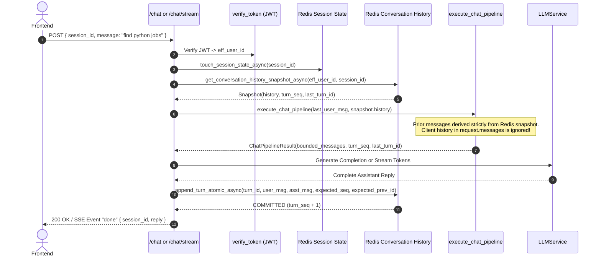

# CollarCheck Phase 2C.2 — Implementation Report: Complete Redis Conversation History Integration & Production Readiness

- **Date:** 2026-11-10
- **Workspace:** `c:\UNG\chatbot_Quadrant`
- **Repository:** `Kun-byte-max/CC-Chatbot-v2`
- **Status:** IMPLEMENTATION COMPLETE & VERIFIED

---

## 1. Executive Summary

In CollarCheck Phase 2C.2, the active conversation history architecture was fully upgraded from frontend-controlled browser memory to **Redis-authoritative storage**. This transition guarantees:

1. **Zero Client History Trust**: The backend no longer trusts or ingests client-supplied message arrays (`request.messages`) for conversational context. Historical turns are loaded strictly from the verified Redis snapshot.
2. **Atomic Completed-Turn Commits**: User prompts and finalized assistant responses are committed atomically via `append_turn_atomic_async(...)` only after response generation and sanitization succeed.
3. **Stream Cancellation & Disconnect Protection**: If a client disconnects midway or an unhandled generation failure occurs during SSE streaming (`/chat/stream`), the turn is aborted immediately and never committed to Redis.
4. **History Retrieval and Clear Endpoints**: Exposes authenticated `GET /chat/history` (chronological snapshot with turn sequence metadata) and `DELETE /chat/history` (clears history, metadata, and idempotency keys while preserving domain search filters).
5. **Full Backward Compatibility**: The updated `ChatRequest` schema accepts `message: str` while gracefully supporting legacy `messages: List[ChatMessage]` without breaking existing frontend or test callers.

---

## 2. File Modification Details

### 2.1 `backend/schemas/schemas.py`
- Updated `ChatRequest` model:
  - Added `message: Optional[str] = None` for modern single-prompt request payloads.
  - Made `messages: Optional[List[ChatMessage]] = None` optional to support both new and legacy callers.
  - Added a `@model_validator(mode="before")` to enforce that at least one of `message`, `messages`, or `action` is present in incoming payloads, maintaining HTTP 422 behavior for unparseable bodies.
- Preserved all other schema attributes (`user_location`, `latitude`, `longitude`, `widgets_data`, `action`, etc.).

### 2.2 `backend/main.py`
- **Imports**:
  - Imported `TurnConcurrencyConflictError`, `PayloadTooLargeError`, `InvalidMessagePayloadError`, `append_turn_atomic_async`, `get_conversation_history_snapshot_async`, and `clear_conversation_history_async` from `backend.utils.conversation_history`.
- **`ChatPipelineResult` Dataclass**:
  - Added `turn_seq: int = 0`, `last_turn_id: Optional[str] = None`, and `user_message: str = ""` to track sequence snapshots across terminal and non-terminal execution branches.
- **`execute_chat_pipeline`**:
  - Current prompt resolution: Extracts `last_user_msg` prioritizing `request.message` over the last user entry in `request.messages`.
  - Empty prompt validation: Rejects requests missing both prompt text and structured actions with HTTP 400 (`"User message content cannot be empty."`).
  - Content validation: Invokes `validate_message_content(last_user_msg, "user")` to reject prohibited tokens (`Bearer`, `<<<RESULTS_DATA`) and oversized payloads (> 8,000 characters).
  - Snapshot loading: Calls `await get_conversation_history_snapshot_async(user_id=u_db_id, session_id=session_id)` immediately following JWT and session ownership validation.
  - Authoritative history assembly: Populates downstream `messages = [{"role": rec.role, "content": rec.content} for rec in hist_snapshot.history] + [{"role": "user", "content": last_user_msg}]`. Client-supplied history in `request.messages` is strictly ignored.
  - Returns `ChatPipelineResult` populated with `turn_seq`, `last_turn_id`, and `user_message`.
- **`/chat` Endpoint**:
  - Terminal path: Commits terminal responses (e.g. guardrails, user_data verification status) atomically before returning `ChatResponse`.
  - Non-terminal path: After LLM generation, validation, and sanitization, commits the turn via `await append_turn_atomic_async(...)` with `expected_seq` and `expected_previous_turn_id`.
  - Exception handling: Traps `TurnConcurrencyConflictError` (HTTP 409), `PayloadTooLargeError` (HTTP 413), and `InvalidMessagePayloadError` (HTTP 400).
- **`/chat/stream` Endpoint**:
  - Terminal path: Emits `delta` event, verifies connection status, commits turn via `append_turn_atomic_async(...)`, then emits `done` event.
  - Non-terminal path: Streams tokens, checks `req.is_disconnected()`. If client disconnected, exits immediately without committing. If intact, sanitizes reply, commits turn via `append_turn_atomic_async(...)`, then emits `done` event.
  - Exception handling: Traps `TurnConcurrencyConflictError`, `PayloadTooLargeError`, and `InvalidMessagePayloadError`, yielding structured SSE `error` events and suppressing the `done` event.
- **`GET /chat/history`**:
  - Validates session format and authenticated JWT user identity.
  - Calls `get_conversation_history_snapshot_async(user_id, session_id, limit=limit)`.
  - Returns chronological message history, `turn_seq`, and `total_messages`.
- **`DELETE /chat/history`**:
  - Validates session format and authenticated JWT user identity.
  - Calls `clear_conversation_history_async(user_id, session_id)`.
  - Removes history list, metadata hash, and idempotency set while preserving domain session state.

### 2.3 `frontend/index.html`
- **Request Payload**:
  - Updated `body` creation in `sendChatJson` / SSE streaming to transmit `message: text` instead of `messages: conversationHistory`.
  - Retained `conversationHistory` array strictly in browser memory for UI presentation (`addUserMessage`, `addAssistantMessage`).
- **`clearChat()`**:
  - Dispatches an asynchronous `DELETE /chat/history` call when an active session ID is cleared, ensuring backend Redis conversation history keys are purged alongside browser state.

---

## 3. Request Flow & Invariants

### Invariants Maintained
1. **Never commit before generation succeeds**: Incomplete or aborted generations are never persisted.
2. **Never emit `done` if commit fails**: If `append_turn_atomic_async` raises an exception (such as `TurnConcurrencyConflictError`), an error event is yielded and the connection terminates without a `done` event.
3. **No client injection**: Even if an adversary injects messages into `request.messages`, only the current user prompt is extracted. All context provided to QueryRewriter, search parsers, and LLM prompts is loaded from Redis.
4. **Clean key isolation**: Clearing conversation history via `DELETE /chat/history` or `clear_conversation_history_async` removes `chat:history:{uid}:{sid}`, `chat:history:meta:{uid}:{sid}`, and `chat:history:turns:{uid}:{sid}` without altering `chat:session:{uid}:{sid}`.

