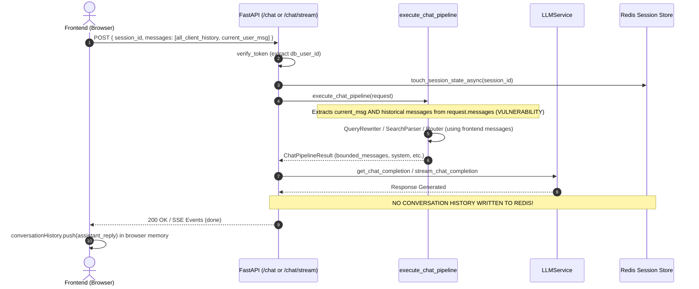
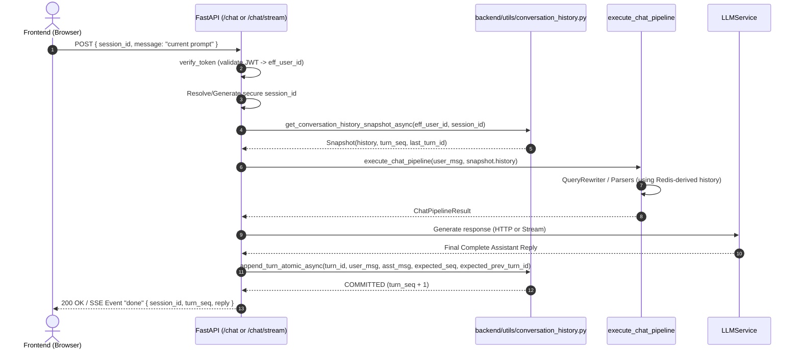

# CollarCheck Phase 2C.2 — Integration Architecture Audit
**Authoritative Baseline & Integration Roadmap for Redis-Backed Conversation History**

- **Date:** 2026-11-10
- **Workspace:** `c:\UNG\chatbot_Quadrant`
- **Repository:** `Kun-byte-max/CC-Chatbot-v2`
- **Status:** READ-ONLY BASELINE AUDIT COMPLETE (Phase 0)

---

## 1. Executive Summary & Existing Architecture

The CollarCheck chatbot currently relies on **client-side memory** (`conversationHistory` array in `frontend/index.html`) to maintain multi-turn conversational context. On each interaction, the frontend transmits its entire historical message array via `request.messages` to `/chat` and `/chat/stream`.

### 1.1 Existing Flaws & Vulnerabilities Identified in Baseline
1. **Frontend-Controlled History Injection**: The backend directly casts `request.messages` into `messages = [{"role": m.role, "content": m.content} for m in request.messages]` and feeds it to Query Rewriting, Intent Parsing, Search Parsing, and LLM Prompt Composition. An attacker or modified frontend can spoof, inject, or tamper with previous assistant statements or user prompts.
2. **Zero Backend History Authoritativeness**: In the current `backend/main.py`, neither `/chat` nor `/chat/stream` commits completed turns to Redis. While Phase 2B successfully migrated *domain session state* (`chat:session:{uid}:{sid}`) and Phase 2C.1 built and hardened the storage module (`backend/utils/conversation_history.py`), the conversation history store remains completely unintegrated into the execution pipeline.
3. **No Terminal Commit Safeguards**: If a client disconnects midway through streaming or the LLM generation fails, the backend has no structured boundary preventing or tracking partial turns.
4. **Missing History Retrieval and Clear Endpoints**: There are currently no backend endpoints for `GET /chat/history` or `DELETE /chat/history`. Chat clearing is handled purely client-side by reassigning `conversationHistory = []`.

### 1.2 Target Architecture
1. **Redis is the Single Authoritative Source**: Conversation history is stored in Redis under `chat:history:{user_id}:{session_id}` (LIST), `chat:history:meta:{user_id}:{session_id}` (HASH), and `chat:history:turns:{user_id}:{session_id}` (SET).
2. **Atomic Snapshot Read**: Early in the request lifecycle (immediately following JWT verification and session ownership checks), the pipeline fetches an atomic snapshot via `get_conversation_history_snapshot_async(user_id, session_id)`.
3. **Downstream Context Injection**: All services (`QueryRewriterService`, `parse_search_query`, `parse_profile_update`, `dispatch_search_target`, `handle_employee_context`, `handle_employer_context`, and LLM prompt builder) receive history derived strictly from the verified Redis snapshot.
4. **Atomic Two-Phase Commit**: The incoming user prompt and the finalized assistant response are committed atomically via `append_turn_atomic_async(...)` **only after** response generation has fully succeeded, using the snapshot's absolute `turn_seq` and `last_turn_id` for strict linearizability.

---

## 2. Production History Consumers Inventory

Every production consumer of conversation history across the codebase was audited:

| # | Consumer Symbol | File & Line | History Source | History Scope | Sync / Async | Calling Endpoint | Pre/Post Completion Execution | Signature Changes Required |
|---|---|---|---|---|---|---|---|---|
| **1** | `request.messages` | `backend/main.py:1240, 1500` | Frontend (Untrusted) | Complete client array | Async | `/chat`, `/chat/stream` | Pre-completion (Pipeline start) | **Yes**: Deprecate trusting `request.messages`; accept optional `message: str` or extract current user prompt only. |
| **2** | `conversationHistory` | `frontend/index.html:1904, 3154` | Frontend browser RAM | Complete client array | Client JS | `sendChatJson` / SSE | Presentation only | **Yes**: Cease transmitting full history array; send `{ message, session_id }`. |
| **3** | `messages` (pipeline local) | `backend/main.py:1500, 1661` | Frontend-derived | Complete array | Async | `/chat`, `/chat/stream` | Pre-completion | **Yes**: Populate from `snapshot.history` instead of `request.messages`. |
| **4** | `history` (bounded) | `backend/main.py:1885-1907` | Frontend-derived | Bounded (`CHAT_HISTORY_TURNS`, default 10) | Async | `/chat`, `/chat/stream` | Pre-completion (Prompt assembly) | **No**: Retain bounded sliding window logic; source messages from Redis snapshot. |
| **5** | `QueryRewriterService.rewrite_query` | `backend/services/query_rewriter.py:206` | Injected parameter `messages_history` | Up to 10 recent messages | Async | Called by `execute_chat_pipeline` | Pre-completion (Step 2) | **No signature change**: Existing parameter `messages_history: Optional[List[Dict[str, Any]]]` is compatible with Redis snapshot records. |
| **6** | `parse_search_query` | `backend/services/search_parser.py:90` | Injected parameter `messages` | Bounded to `messages[-5:]` | Async | Called by `execute_chat_pipeline` | Pre-completion (Step 4) | **No signature change**: Accepts `messages: list = None`. |
| **7** | `parse_profile_update` | `backend/services/profile_parser.py:16` | Injected parameter `messages` | Bounded to `messages[-5:]` | Async | Called by `execute_chat_pipeline` | Pre-completion (Step 3) | **No signature change**: Accepts `messages: list = None`. |
| **8** | `dispatch_search_target` | `backend/services/search_router.py:29` | Injected parameter `messages` | Passes through to target handlers | Async | Called by `execute_chat_pipeline` | Pre-completion (Step 5) | **No signature change**: Accepts `messages: Optional[list] = None`. |
| **9** | `handle_employee_context` | `backend/api/employee.py:320` | Injected parameter `messages` | Passes to `parse_search_query` | Async | Called via search router | Pre-completion | **No signature change**: Accepts `messages: list = None`. |
| **10** | `handle_employer_context` | `backend/api/employer.py:128` | Injected parameter `messages` | Search context extraction | Async | Called via search router / employer endpoints | Pre-completion | **No signature change**: Accepts `messages: list = None`. |
| **11** | `execute_chat_pipeline` | `backend/main.py:1227` | `request.messages` | Complete request | Async | `/chat`, `/chat/stream` | Pre-completion | **Internal Change**: Accept Redis snapshot records; remove frontend history dependency. |
| **12** | `LLMService.get_chat_completion` | `backend/services/llm_service.py:121` | Injected `messages` | Bounded prompt messages | Async | `/chat` | Pre-completion (LLM call) | **No signature change**: Accepts `messages: list`. |
| **13** | `LLMService.stream_chat_completion` | `backend/services/llm_service.py:205` | Injected `messages` | Bounded prompt messages | Async generator | `/chat/stream` | During streaming | **No signature change**: Accepts `messages: list`. |

---

## 3. Request Lifecycle Analysis

### 3.1 Existing Flow (`/chat` & `/chat/stream`)

### 3.2 Target Flow with Authoritative Redis Conversation History

---

## 4. Endpoints & Streaming Lifecycle Analysis

### 4.1 `/chat` Lifecycle
1. **Authentication & Session Resolution**:
   - `verify_token` extracts trusted `db_user_id`.
   - `is_valid_session_id` checks format; missing or default session ID generates a cryptographically secure ID via `generate_secure_session_id()`.
2. **Snapshot Load**:
   - Executes `snapshot = await get_conversation_history_snapshot_async(user_id=eff_user_id, session_id=session_id)`.
   - Obtains validated `snapshot.history`, `expected_seq = snapshot.turn_seq`, and `expected_prev_turn_id = snapshot.last_turn_id`.
3. **Pipeline Execution**:
   - `execute_chat_pipeline` builds downstream history from `snapshot.history`.
   - If terminal response is returned early (guardrails, boundary restriction), it constitutes a completed turn.
4. **Generation & Verification**:
   - LLM produces full completion text.
   - Reply validation and sanitization run.
5. **Atomic Commit**:
   - Calls `append_turn_atomic_async(user_id, session_id, turn_id, user_msg, reply, expected_seq=expected_seq, expected_previous_turn_id=expected_prev_turn_id)`.
   - Returns `ChatResponse` with `session_id` and verified output.

### 4.2 `/chat/stream` Lifecycle & SSE Event Ordering
1. **Preamble**: Same as `/chat` (auth, session validation, Redis snapshot load).
2. **Event Sequence**:
   - `results` event: emitted if search returned job/candidate cards.
   - `status` event: `{"stage": "generating", "message": "Generating response..."}`.
   - Keepalive comments: `: keepalive` emitted every 15s to keep connections alive.
   - `delta` events: streamed token-by-token (or single framed delta for card results).
3. **Completion & Atomic Persistence**:
   - Stream finishes; backend memory holds `accumulated_reply = "".join(accumulated_chunks)`.
   - Reply is validated and sanitized: `final_reply = sanitize_job_results_reply(...)`.
   - **Crucial Invariant**: `append_turn_atomic_async` MUST execute and succeed **before** `done` event is yielded.
   - If commit fails (e.g. `RedisUnavailableError` or `TurnConcurrencyConflictError`), an `error` SSE event is emitted; `done` is NEVER emitted.
4. **Cancellation & Disconnect Protection**:
   - Before and during delta streaming, `await req.is_disconnected()` is checked.
   - If client disconnects or cancellation occurs (`asyncio.CancelledError`), the stream generator exits immediately.
   - **`append_turn_atomic_async` is NEVER called for aborted generations.** Incomplete assistant text never enters Redis history.

### 4.3 New Endpoints to Implement (Phase 5)
1. **`GET /chat/history`**:
   - Auth required via `Depends(verify_token)`.
   - Query parameters: `session_id: str`, `limit: Optional[int] = None`.
   - Calls `get_conversation_history_snapshot_async(user_id, session_id, limit=limit)`.
   - Returns: `{ "success": True, "session_id": session_id, "turn_seq": snapshot.turn_seq, "messages": [...] }`.
2. **`DELETE /chat/history`**:
   - Auth required via `Depends(verify_token)`.
   - Query parameters / payload: `session_id: str`.
   - Calls `clear_conversation_history_async(user_id, session_id)`.
   - Deletes `chat:history:{uid}:{sid}`, `chat:history:meta:{uid}:{sid}`, and `chat:history:turns:{uid}:{sid}`.
   - Preserves `chat:session:{uid}:{sid}` (domain search/filter state).

---

## 5. Compatibility Risks & Mitigations

| Risk | Impact | Mitigation Strategy |
|---|---|---|
| **Legacy Frontend Request Payload** | Existing clients transmit `{ messages: [...] }` without a dedicated `message` property. | In `ChatRequest`, make `message: Optional[str] = None`. In `main.py`, extract the current user prompt from `request.message` if present, else fallback to the last user message in `request.messages`. Historical messages in `request.messages` are strictly ignored and never used as context. |
| **Concurrent Request Turn Collisions** | Two requests from the same user session run simultaneously with `expected_seq=N`. | Storage layer raises `TurnConcurrencyConflictError`. Backend traps this error and returns an HTTP 409 or structured SSE `error` event (`error_code="CONCURRENCY_CONFLICT"`), preventing corrupted interleaving. |
| **History Trimming Distorting Turn Sequence** | Trimming older pairs to stay under `MAX_SESSION_BYTES` could alter sequence numbering if derived from list length. | The storage module's `turn_seq` is stored in the metadata hash as a monotonically increasing absolute counter. `snapshot.turn_seq` is used directly; it is never computed from `len(history)`. |
| **Leaking Prohibited Tokens into History** | Raw retrieval results, system prompt blocks, or Bearer credentials entering conversation history. | `validate_message_content()` pre-checks `FORBIDDEN_CONTENT_PATTERNS` before writing to Redis; raw search descriptions (`<<<RESULTS_DATA`) remain ephemeral to prompt composition and are never stored in history. |

---

## 6. Recommended Phase Execution Plan

- **Phase 1: Backend-Authoritative History Integration**
  - Update `ChatRequest` schema.
  - Load Redis snapshot at request start in `execute_chat_pipeline`.
  - Discard frontend-supplied history context.
  - Implement focused unit tests in `test_phase2c2_pipeline_integration.py`.
- **Phase 2: Downstream Services Integration**
  - Verify that `QueryRewriterService`, `search_parser`, `profile_parser`, `search_router`, `employee.py`, and `employer.py` receive snapshot-derived history.
- **Phase 3: Successful Turn Commit Lifecycle**
  - Wire `append_turn_atomic_async()` into `/chat` endpoint after completion and validation.
  - Traps and maps `TurnConcurrencyConflictError`, `PayloadTooLargeError`, `RedisUnavailableError`.
- **Phase 4: SSE Streaming Lifecycle & Cancellation Protection**
  - Buffer full reply in `chat_stream`.
  - Execute `append_turn_atomic_async()` prior to emitting `done`.
  - Guard against client disconnect and cancellation.
- **Phase 5: History Retrieval & Clear Endpoints**
  - Expose `GET /chat/history` and `DELETE /chat/history` in `backend/main.py`.
- **Phase 6: Frontend Integration**
  - Update `frontend/index.html` `sendChatJson()` and `chat_stream` callers.
  - Send `{ message, session_id }`; maintain local `conversationHistory` for presentation only.
- **Phase 7: Observability & Security**
  - Maintain `set_history_metrics(sent, dropped)`.
  - Ensure zero sensitive credentials in logs.
- **Phase 8: End-to-End & Regression Verification**
  - Run all targeted regression suites.
- **Phase 9: Final Independent Audit**
  - Final read-only audit and GO/NO-GO delivery.

---

## 7. Storage API Readiness Check

The existing `backend/utils/conversation_history.py` module exposes:
- `get_conversation_history_snapshot_async(user_id, session_id, limit=None) -> ConversationHistorySnapshot`
  - Provides `history`, `turn_seq`, `last_turn_id`, `total_messages`, and `updated_at`.
- `append_turn_atomic_async(user_id, session_id, turn_id, user_message, assistant_message, metadata, expected_previous_turn_id, expected_seq) -> TurnCommitResult`
  - Atomic two-message commit with complete pair trimming and strict sequence collision detection.
- `clear_conversation_history_async(user_id, session_id) -> bool`
  - Clears history list, metadata hash, and idempotency set atomically.

**Conclusion:** The existing storage API satisfies 100% of the integration requirements. We are ready to proceed with Phase 1.

